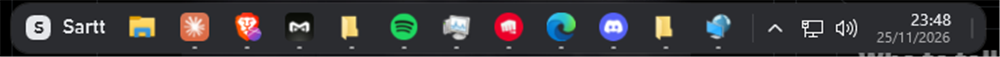



# SarttBar

Uma barra de tarefas flutuante e personalizada para Windows, com identidade própria, que substitui a barra do Windows **sem perder funcionalidade**: apps abertos e fixados, bandeja do sistema (ícones em segundo plano), relógio, menu Iniciar, miniaturas das janelas e notificações continuam funcionando.

> A SarttBar é um fork do [RetroBar](https://github.com/dremin/RetroBar), de Sam Johnson (dremin), e usa a biblioteca [ManagedShell](https://github.com/cairoshell/ManagedShell). O tema clássico original e todas as funções do RetroBar continuam disponíveis.

## Destaques

- **Barra flutuante e compacta**: centralizada, cantos arredondados, cresce só quando há muitos apps abertos.
- **Posicione onde quiser**: arraste pelo nome *Sartt* para qualquer ponto da tela. Soltando numa borda, ela gruda ali (vertical nas laterais), lembrando o ponto exato da borda.
- **Menu "Posição da barra"** (botão direito no fundo da barra): centralizar embaixo/em cima, lado esquerdo/direito.
- **Apps fixados no centro**: o atalho fixado some quando o app abre e o botão do app aberto toma o lugar.
- **Bandeja organizada**: ícones em segundo plano ficam atrás de uma setinha, num painel que desliza para cima. Volume, rede e energia ficam sempre visíveis.
- **Painéis próprios no estilo Sartt**, abrindo em cima do ícone clicado:
  - **Volume**: volume geral, mudo, troca do dispositivo de saída e **mixer por app** (3 apps por página).
  - **Rede**: conexão atual, status da Internet, IP e atalhos para as configurações.
  - **Data**: hora com segundos, data por extenso e calendário navegável.
- **Animações**: ampliação estilo dock ao passar o mouse, ícones novos entram com um pulinho, a barra "levanta" ao ser arrastada e "surge" ao encaixar, o logo inclina no hover.
- **Flutua sobre os apps**: apps maximizados ocupam a tela inteira. Em tela cheia de verdade (jogos, vídeos), a barra sai da frente.
- **Leve**: em repouso usa ~0,1% de CPU e ~140 MB de RAM (medido num PC de 12 núcleos), menos que o Explorer do Windows.

## Tecnologias usadas

| Tecnologia | Uso |
|---|---|
| **C# / .NET 10** | Linguagem e runtime da aplicação |
| **WPF (XAML)** | Interface, temas, estilos e animações |
| **[ManagedShell](https://github.com/cairoshell/ManagedShell)** | Integração com o shell do Windows: lista de janelas, bandeja do sistema, AppBar, miniaturas |
| **Win32 / P/Invoke** | Posicionamento de janelas, área de trabalho, auto-ocultar da barra do Windows, atalhos `.lnk` |
| **Core Audio (COM)** | Volume geral, mudo, dispositivos de saída e mixer por app (`IAudioEndpointVolume`, `IAudioSessionManager2`, `ISimpleAudioVolume`) |
| **Network List Manager (COM)** e `System.Net.NetworkInformation` | Status da conexão e da Internet |
| **[gong-wpf-dragdrop](https://github.com/punker76/gong-wpf-dragdrop)** | Reordenar ícones arrastando |

## Requisitos

- Windows 10 ou 11 (testado no Windows 10 22H2)
- [.NET 10 SDK](https://dotnet.microsoft.com/download/dotnet/10.0), para compilar

## Guia de instalação

1. **Instale o .NET 10 SDK** (pelo site acima ou pelo terminal):
   ```powershell
   winget install --id Microsoft.DotNet.SDK.10 -e
   ```
2. **Baixe o código**:
   ```powershell
   git clone https://github.com/HenriqueSS0/TaskBar-Sartt.git
   cd TaskBar-Sartt
   ```
3. **Compile**:
   ```powershell
   dotnet build RetroBar\RetroBar.csproj -c Release -f net10.0-windows
   ```
4. **Abra a barra**:
   ```powershell
   Start-Process .\RetroBar\bin\Release\net10.0-windows\RetroBar.exe
   ```
   O tema *Flutuante* (Sartt) já vem como padrão.

### Iniciar junto com o Windows

Escolha uma das opções:

- **Pela própria barra (recomendado)**: botão direito no fundo da barra → **Propriedades** → marque **Iniciar automaticamente no logon**. Para desfazer, desmarque a mesma opção.
- **Pelo PowerShell**, a partir da pasta do projeto:
  ```powershell
  $exe = (Resolve-Path .\RetroBar\bin\Release\net10.0-windows\RetroBar.exe).Path
  New-ItemProperty -Path "HKCU:\Software\Microsoft\Windows\CurrentVersion\Run" -Name "RetroBar" -Value "`"$exe`"" -PropertyType String -Force
  ```
  Para desfazer:
  ```powershell
  Remove-ItemProperty -Path "HKCU:\Software\Microsoft\Windows\CurrentVersion\Run" -Name "RetroBar"
  ```

As duas opções usam a mesma entrada do registro (`RetroBar`), então a caixa nas Propriedades reflete o que foi feito pelo PowerShell e vice-versa. Se você mover a pasta do projeto, marque a opção de novo para atualizar o caminho.

### Esconder a barra do Windows

Não precisa fazer nada: a SarttBar já cuida disso sozinha.

- **Enquanto ela está aberta**, a barra do Windows fica escondida e a SarttBar ocupa o lugar dela.
- **No boot**, a SarttBar liga o "ocultar automaticamente" da barra do Windows. Assim ela não aparece nos segundos antes da SarttBar abrir. Se um dia a SarttBar não abrir, a do Windows continua acessível: é só encostar o mouse na borda de baixo.

### Voltar para a barra do Windows

Botão direito no fundo da barra → **Sair da SarttBar**. A barra do Windows volta ao normal, inclusive com o "ocultar automaticamente" desligado. Para parar de iniciar com o Windows, desmarque também a opção nas Propriedades (veja acima).

## Personalização

Toda a identidade visual fica em um único arquivo: [`RetroBar/Themes/Flutuante.xaml`](RetroBar/Themes/Flutuante.xaml). Para personalizar sem recompilar, copie-o para `%LOCALAPPDATA%\RetroBar\Themes\`, edite e reabra a barra (ou troque o tema em **Propriedades**).

### Cores (seção `PALETA`)

| Recurso | O que muda |
|---|---|
| `FloatAccentColor` / `FloatAccent` | Cor de destaque: logo, indicador do app ativo, controles deslizantes |
| `FloatBackground` | Fundo da barra |
| `FloatPopupBackground` | Fundo dos painéis e da bandeja |
| `FloatForeground` / `FloatMuted` | Texto principal e secundário |
| `FloatHover` / `FloatActive` / `FloatPressed` | Realces de hover, ativo e clique |

### Marca (seção `MARCA`)

| Recurso | O que muda |
|---|---|
| `BrandText` | Nome exibido ao lado do logo (padrão: `Sartt`) |
| `BrandFont` | Fonte do nome e dos títulos dos painéis |
| `LogoFont` / `LogoForeground` | Fonte e cor da letra do logo |

O desenho do logo fica no estilo `StartButton` (procure por `Logo Sartt`). Dá para trocar o selo com a letra por qualquer vetor (`Path`) ou imagem.

### Tamanho e comportamento

| Recurso | O que muda |
|---|---|
| `TaskbarHeight` / `TaskbarWidth` | Altura (horizontal) e largura (vertical) da faixa da barra |
| `TaskButtonWidth` | Largura de cada botão de app |
| `DockMagnification` | Quanto o ícone sob o mouse cresce (`1` desliga) |
| `DockMagnificationRadius` | Até onde os vizinhos crescem junto (menor = só o ícone sob o mouse) |
| `AnimateAppear` | Animação de "surgir" ao abrir e ao encaixar numa borda |
| `TaskButtonPopIn` | Pulinho dos ícones de apps recém-abertos |
| `SarttFlyouts` | Painéis próprios de volume, rede e data (`False` volta aos do Windows) |
| `FloatOverWindows` | Flutuar sobre os apps em vez de reservar espaço na tela |
| `AllowDragWhenLocked` | Permite arrastar a barra mesmo travada |
| `TrayOverflowPopup` | Ícones ocultos da bandeja num painel em vez de expandir a barra |
| `CompactTaskbar` | Barra do tamanho do conteúdo, com apps fixados no centro |

### Configurações do usuário

Ficam em `%LOCALAPPDATA%\RetroBar\settings.json` (tema, posição salva, borda, comportamento dos ícones da bandeja etc.) e podem ser alteradas pelas **Propriedades** da barra.

## Licença

Distribuído sob a licença **GPL-3.0**, a mesma do projeto original. Veja [LICENSE](LICENSE). Créditos do código base: [RetroBar](https://github.com/dremin/RetroBar) e [ManagedShell](https://github.com/cairoshell/ManagedShell).
